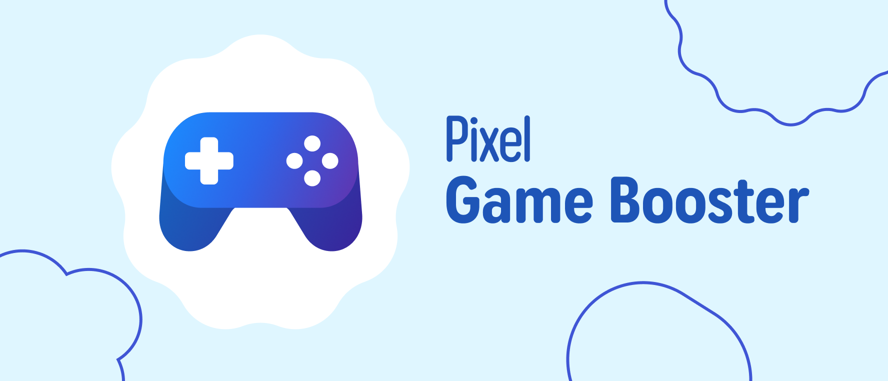
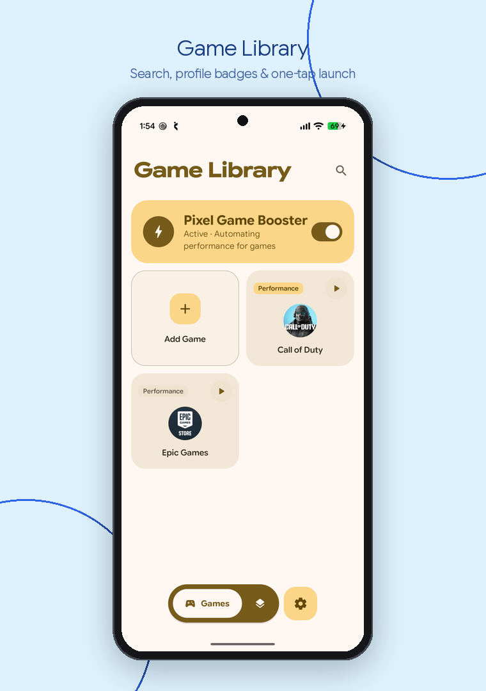
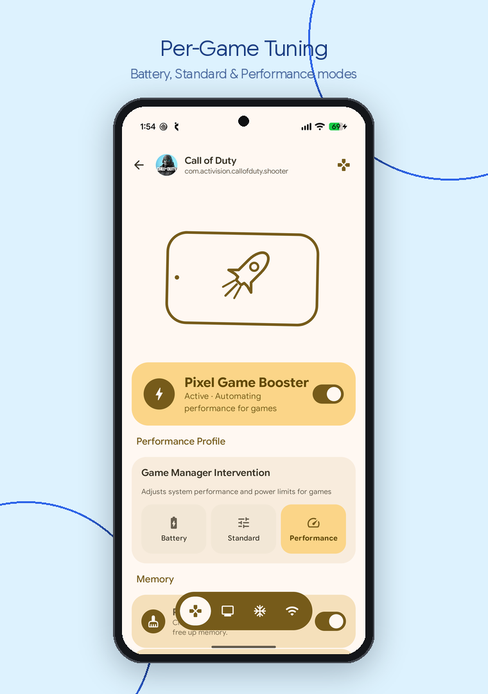
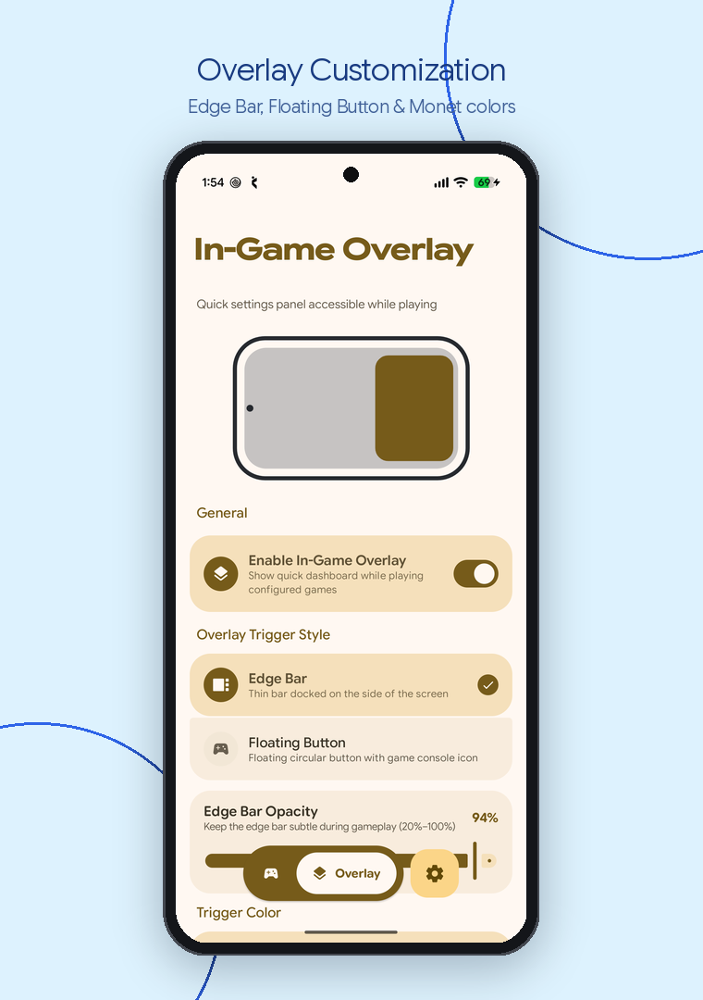
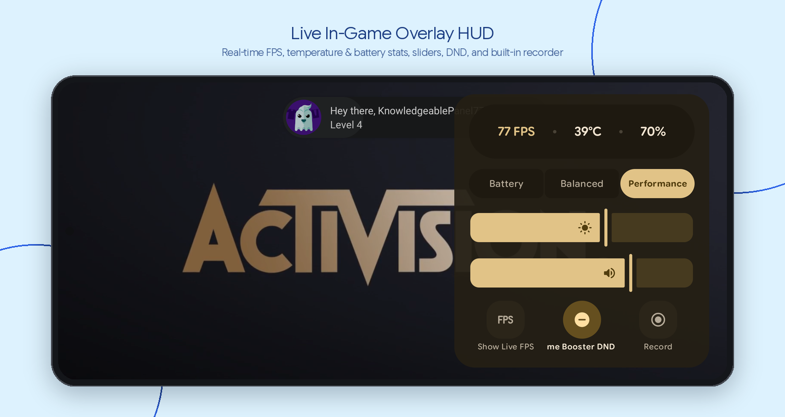

<p align="center">
  
</p>

# Pixel Game Booster

A clean, **Material 3 Expressive** performance booster and in-game overlay built for Google Pixel phones — no root required. *(It may work on other Android devices too, but it hasn't been tested on them.)*

<p align="center">
  
  
  
  <a href="LICENSE"></a>
</p>

---

## Screenshots

| | | |
| :---: | :---: | :---: |
|  |  |  |

<p align="center">
  
</p>

---

## Why I Built This

Even on flagship Pixel phones, games can still suffer from sudden frame drops, micro-stutters, and ping spikes. After tracing live gameplay sessions, the main culprits were background Google AI/system services waking up mid-match, Wi-Fi background scans and Private DNS lookups causing lag spikes, and the display dropping down from 120Hz.

**Pixel Game Booster** automates fixing all of those the moment you open a game, gives you a customizable in-game overlay, and safely restores every setting when you exit.

---

## Features

### Automatic Game Detection & Per-Game Profiles
- **Auto Start & Restore:** Automatically turns on when you launch a game, switches smoothly between games, and restores all settings when you exit.
- **Game Library:** Search your games, see active profiles at a glance, and launch games with one tap.
- **Per-Game Tuning:** Use global defaults or customize **Performance**, **Display**, **Suspension**, and **Network** settings per game.
- **Crash & Force-Stop Recovery:** Automatically restores DND, 120Hz, auto-brightness, back gestures, battery saver, Private DNS, and paused apps/services if the app is killed mid-game.

### Performance, Display & Interruption Control
- **Performance Modes:** Switch between **Battery**, **Standard**, and **Performance** profiles.
- **120Hz Display Lock:** Keeps your screen locked at 120Hz to prevent sudden refresh-rate dips.
- **Memory & App Freezer:** Clears background apps, enables Android's app freezer, and pauses selected user apps or background Google services (like AICore, Device Health Services, and Adaptive Connectivity) while you play.
- **Distraction-Free Gaming:** Locks auto-brightness, disables accidental edge back gestures, turns off Quick Tap, and enables **Game DND** (silences notifications while keeping game audio).

### Network & Power Stabilization
- **Lower Ping & Fewer Spikes:** Keeps Wi-Fi in high-performance/low-latency mode, pauses background Wi-Fi & Bluetooth scans, and prevents sudden network switches.
- **Private DNS & Sync Bypass:** Temporarily turns off Private DNS and pauses master auto-sync while gaming — then restores everything on exit.
- **Battery Saver Protection:** Prevents Battery Saver from throttling performance mid-match (with low-battery alerts at 20%, 10%, and 5%).

### Customizable In-Game Overlay & Screen Recorder
- **Edge Bar or Floating Button:** Pick your style, adjust opacity (20%–100%), and match your wallpaper (**Monet**) or pick any custom color.
- **Drag-and-Drop Layout Editor:** Reorder overlay sections and action buttons with a live preview, and choose which stats appear (**FPS**, **Temp**, **Wattage**, **Battery %**).
- **Custom Gestures:** Bind **Double Tap** and **Long Tap** to open the overlay, take a screenshot, start/stop recording, toggle live FPS, purge RAM, or cycle performance modes.
- **Quick Sliders & Tiles:** Adjust brightness and media volume smoothly, toggle 120Hz, DND, or back-gesture lock right from the HUD.
- **Built-In Screen Recorder:** Record gameplay with **Mute**, **Mic**, **Device Audio**, or **Game + Mic**, customizable resolution/FPS, visual touches, and **Double Tap to Stop**.

### Polish & Customization
- **Adaptive UI:** Supports both phones and wide-screen foldables/tablets.
- **Themes & Feedback:** System, Light, and Dark modes, tactile haptics, and optional Game Mode toast notifications.

---

## Requirements

Pixel Game Booster works **without root** using **Shizuku**:
1. **Shizuku** — Needed for display locks, performance modes, app suspension, and network tweaks.
2. **Accessibility Service & Usage Access** — Detects when you open or leave a game.
3. **Display Over Other Apps & Modify System Settings** — Powers the in-game overlay and brightness slider.
4. **Do Not Disturb & Notifications** — Powers Game DND and background service status.

---

## Building

Requires **JDK 21** and **Android SDK 37.1**.

```bash
./gradlew testDebugUnitTest
./gradlew assembleDebug
```

Release builds (`assembleRelease` / `bundleRelease`) require signing credentials (`RELEASE_STORE_FILE`, `RELEASE_STORE_PASSWORD`, `RELEASE_KEY_ALIAS`, `RELEASE_KEY_PASSWORD`) in `local.properties` or environment variables.
